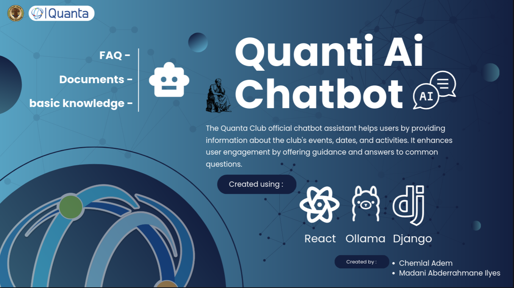
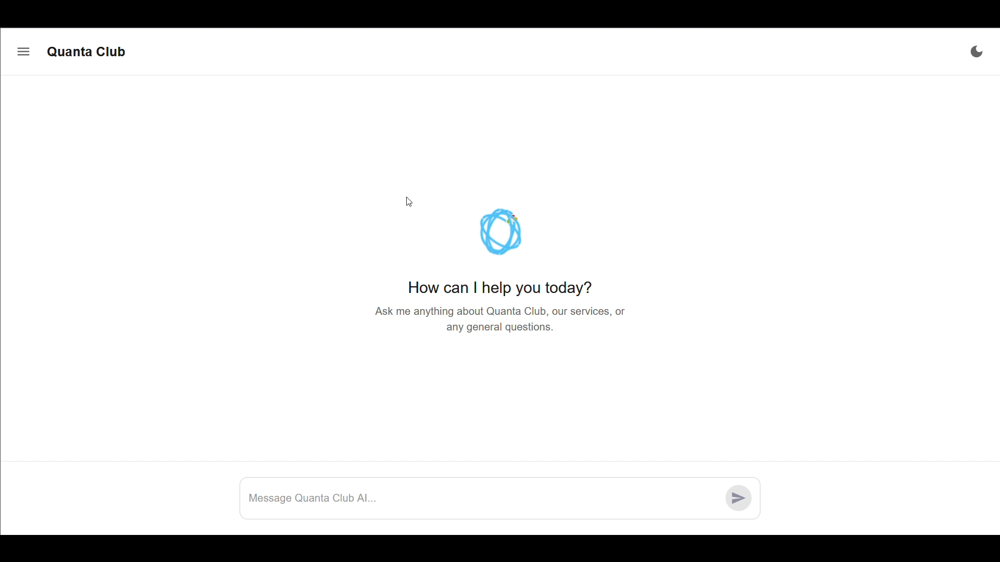
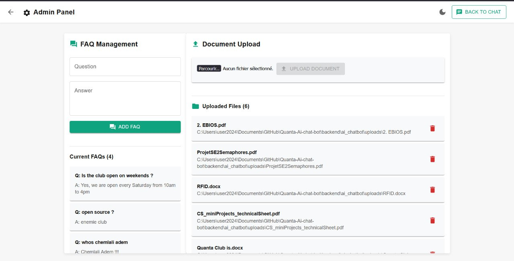
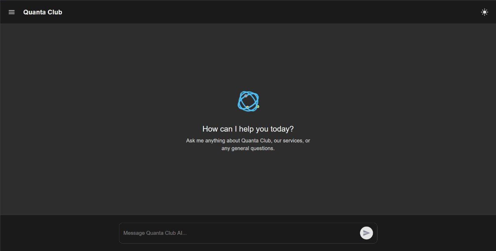

# Quanta AI Chatbot

Quanta AI Chatbot is a web application for the Quanta Club. It gives visitors a
public chat interface for questions about the club and gives authenticated
administrators tools to manage the chatbot's knowledge base and frequently
asked questions.


<video controls src="20250715-1142-43.0450813.mp4" title="Title"></video>






With Dark mode active



The application combines:

- A React interface built with Vite and Material UI.
- A Django REST API backed by SQLite.
- A local Ollama model named `quanta-chatbot`.
- Semantic document search using `sentence-transformers` and FAISS.
- JWT authentication and role-based administration.
- Database-backed conversation history with browser-side persistence.

> **Project status:** This is a development-oriented version. The default
> settings enable Django debug mode, allow broad CORS access, use development
> credentials/settings, and are not suitable for production without hardening.

## Table of contents

1. [What the application does](#what-the-application-does)
2. [Main features](#main-features)
3. [Architecture](#architecture)
4. [Repository layout](#repository-layout)
5. [Requirements](#requirements)
6. [Installation](#installation)
7. [Running the application](#running-the-application)
8. [First administrator](#first-administrator)
9. [User roles and registration approval](#user-roles-and-registration-approval)
10. [Chat and knowledge-base pipeline](#chat-and-knowledge-base-pipeline)
11. [Conversation memory and persistence](#conversation-memory-and-persistence)
12. [Response-time display](#response-time-display)
13. [API reference](#api-reference)
14. [Data model](#data-model)
15. [Frontend routes](#frontend-routes)
16. [Testing and quality checks](#testing-and-quality-checks)
17. [Configuration](#configuration)
18. [Troubleshooting](#troubleshooting)
19. [Security and production checklist](#security-and-production-checklist)
20. [Known limitations](#known-limitations)

## What the application does

Visitors can:

- Open the landing page and chat with the assistant.
- Browse common questions and select an answer directly.
- Continue a conversation without repeating earlier context.
- Clear their conversation and start a new session.
- Register an account request for administrator review.

Approved administrators can:

- Sign in with email and password.
- Upload PDF, DOCX, and TXT documents.
- View and delete uploaded files.
- Add, edit, and delete common questions.
- Use the same public chat interface.

Super administrators can additionally:

- View pending registration requests.
- Approve or decline registration requests.
- Provide a reason when declining a request.
- View administrator accounts and remove administrator accounts.

## Main features

### Public AI chat

The chat endpoint is public. A question is first compared with the configured
common questions. A close match returns the stored FAQ answer immediately.
Otherwise, the backend searches uploaded document chunks and sends the selected
context, recent conversation history, and the current question to Ollama.

The response is streamed to the browser as it is generated.

### File-based knowledge base

Authenticated administrators can upload:

- `.pdf`
- `.docx`
- `.txt`

The backend extracts text, splits it into sentence-based chunks, creates
384-dimensional `all-MiniLM-L6-v2` embeddings, and stores the chunks and
embeddings in the database. At chat time, FAISS performs nearest-neighbor
search and the best matching chunks are added to the model prompt.

The Django upload endpoint limits files to 10 MB and rejects unsupported
extensions or files from which no text can be extracted.

### Common questions

Common questions are stored in the database. The public interface can list
them, and administrators can create, update, and delete them. The chat
endpoint uses fuzzy matching to return a matching answer before invoking the
language model.

### Authentication

The application uses:

- A custom Django `User` model with email as the login identifier.
- Password hashing through Django.
- JWT access and refresh tokens using
  `djangorestframework-simplejwt`.
- Protected frontend routes and authenticated API requests.
- Refresh-token blacklisting during logout.

### Registration approval

Public registration creates a pending `RegistrationRequest`; it does not
immediately create a usable account. A super administrator must approve the
request before the user can log in. A declined request includes a reason that
can be displayed to the applicant.

### Conversation memory

Each browser conversation has a generated `session_id`. The backend stores
messages in `Conversation` and `ChatMessage` records. Up to the latest ten
messages are included in the model prompt to keep context manageable.

The React `ChatProvider` also saves the visible chat log in `localStorage`, so
the interface can restore it after a refresh. Clearing chat deletes the
backend conversation, removes the local history, and creates a new session ID.

### Response timer

The frontend starts a timer when a chat request begins, updates the elapsed
time every 100 milliseconds while waiting, and displays the completed response
time in seconds next to the latest bot response.

## Architecture

### Primary application

The normal application path is:

```text
React/Vite frontend
        |
        | HTTP requests and streamed chat responses
        v
Django REST API (localhost:8000)
        |
        +-- SQLite database
        +-- uploaded documents and extracted chunks
        +-- sentence-transformers + FAISS retrieval
        +-- Ollama model: quanta-chatbot
```

The frontend currently uses `http://localhost:8000/api` as its API base URL.
The Django project exposes the API under `/api/`.

### Legacy standalone Flask backend

The repository also contains `backend/app.py`, an earlier standalone Flask
implementation. It provides its own in-memory FAISS index and routes for chat
and document upload, and runs on port 5000 when executed directly.

It is **not the same backend as the Django application**:

- It does not use the Django database models.
- Its embeddings and chunks live only in process memory.
- It uses a different chunk size and retrieval limit.
- It has fewer management and authentication features.

For the current React application, use the Django backend described above.
Treat `backend/app.py` as legacy/reference code unless you intentionally want
to run that separate Flask service.

## Repository layout

```text
Quanta-Ai-chat-bot/
├── backend/
│   ├── app.py                         # Legacy standalone Flask backend
│   ├── dectionnaire.txt               # SymSpell dictionary for legacy code
│   ├── faq.json                       # Legacy FAQ data
│   ├── setup_registration_system.py   # Registration setup helper
│   ├── ai_chatbot/
│   │   ├── manage.py                  # Django management entry point
│   │   ├── db.sqlite3                 # Development database
│   │   ├── uploads/                   # Uploaded document storage
│   │   ├── ai_chatbot/
│   │   │   ├── settings.py            # Django configuration
│   │   │   └── urls.py                # Project URL configuration
│   │   └── ai_chat/
│   │       ├── models.py               # Users, files, FAQs, conversations
│   │       ├── views.py                # API behavior
│   │       ├── urls.py                 # API routes
│   │       ├── migrations/             # Database migrations
│   │       └── management/commands/   # Admin creation commands
│   └── ...
├── frontend/
│   └── ai_interface/
│       ├── package.json                # Frontend dependencies/scripts
│       ├── vite.config.js
│       └── src/
│           ├── App.jsx                 # Routes and providers
│           ├── ChatContext.jsx         # Chat state and persistence
│           ├── AuthContext.jsx         # Authentication state
│           ├── chat.jsx                # Chat UI
│           ├── AdminPanel.jsx          # Admin management UI
│           ├── Login.jsx
│           ├── Register.jsx
│           └── ProtectedRoute.jsx
├── requirements.txt                    # Python dependencies
├── setup_auth.py                        # Interactive setup helper
└── test_*.py / quick_test.py            # Development test scripts
```

The checked-in SQLite databases, generated vector data, Python bytecode, and
uploaded files are development artifacts. A production deployment should
configure persistent storage and review what belongs in version control.

## Requirements

Install the following before starting:

- Python 3.10+ recommended.
- Node.js and npm.
- Ollama.
- The local Ollama model named `quanta-chatbot`.
- Enough memory for `sentence-transformers`, FAISS, and the local language
  model.

The Python dependencies are pinned in [`requirements.txt`](requirements.txt).
The frontend dependencies and scripts are defined in
[`frontend/ai_interface/package.json`](frontend/ai_interface/package.json).

Install and prepare Ollama separately:

```bash
ollama serve
```

The application calls the model by the exact name `quanta-chatbot`. Import or
build a model with that name before sending chat requests. The repository does
not include the model itself.

## Installation

From the project root:

```bash
python -m venv .venv
source .venv/bin/activate
python -m pip install -r requirements.txt

cd frontend/ai_interface
npm install
cd ../..
```

Initialize the Django database:

```bash
cd backend/ai_chatbot
python manage.py makemigrations
python manage.py migrate
cd ../..
```

`setup_auth.py` can perform most of this setup interactively:

```bash
python setup_auth.py
```

The helper installs Python and frontend dependencies, runs migrations, and
creates a regular admin account. Review it before using it in a production
environment.

## Running the application

Start Ollama in one terminal:

```bash
ollama serve
```

Start Django in a second terminal:

```bash
cd backend/ai_chatbot
python manage.py runserver
```

Start Vite in a third terminal:

```bash
cd frontend/ai_interface
npm run dev
```

Then open the URL printed by Vite, normally:

- Landing page: `http://localhost:5173/`
- Chat: `http://localhost:5173/chat`
- Login: `http://localhost:5173/login`
- Registration: `http://localhost:5173/register`
- Admin panel: `http://localhost:5173/admin`

The Django API normally runs at `http://localhost:8000/api/`.

## First administrator

From `backend/ai_chatbot`, create a regular administrator with:

```bash
python manage.py create_admin \
  --email admin@example.com \
  --username admin \
  --password 'change-this-password'
```

To create a super administrator:

```bash
python manage.py create_super_admin \
  --email superadmin@example.com \
  --username superadmin \
  --password 'change-this-password'
```

Use a strong password and do not place real credentials in shell history,
documentation, or source control.

## User roles and registration approval

### Visitor

- Can use public chat.
- Can view common questions.
- Can submit a registration request.
- Cannot use protected administrator endpoints.

### Regular administrator

- Has visitor capabilities.
- Can upload and delete documents.
- Can manage common questions.
- Cannot approve or decline registration requests.

### Super administrator

- Has all regular administrator capabilities.
- Can list, approve, and decline registration requests.
- Can manage administrator accounts.

### Approval flow

1. A visitor submits email, username, and password at `/register`.
2. The backend stores a pending `RegistrationRequest`.
3. A super administrator reviews pending requests.
4. Approval creates an approved administrator account.
5. Declining records a reason.
6. Only approved accounts can log in.

## Chat and knowledge-base pipeline

For a normal Django chat request:

1. The frontend sends `message` and `session_id` to `POST /api/chat`.
2. The backend saves the user message.
3. The backend checks common questions using fuzzy matching.
4. If there is a close FAQ match, its answer is saved and returned.
5. Otherwise, the question is embedded and compared with stored document
   embeddings using FAISS.
6. Up to three relevant chunks and up to ten recent messages are placed in
   the prompt.
7. Ollama generates a response using `quanta-chatbot`.
8. The response is streamed to the frontend.
9. The completed bot response is saved to the conversation.

Uploaded documents follow this path:

```text
upload -> validate extension/size -> save file -> extract text
        -> split into chunks -> create embeddings
        -> store UploadedFile and Chunk records
```

The supported extractors are PyMuPDF for PDF, `python-docx` for DOCX, and
UTF-8 text reading for TXT.

## Conversation memory and persistence

The backend models are:

- `Conversation`: one record per `session_id`.
- `ChatMessage`: ordered user and bot messages belonging to a conversation.

The model prompt includes only the ten most recent messages. This is a prompt
size limit, not a deletion limit: older messages remain in the database until
the conversation is cleared.

The frontend stores the displayed `chatLog` in browser `localStorage`.
Because `ChatProvider` wraps the application, the chat state remains available
when navigating between chat and admin pages during the same page session.

To clear a chat:

- The frontend calls `POST /api/clear-conversation/`.
- The backend deletes the selected conversation.
- The frontend removes `chatHistory`.
- A new `session_id` is generated.

## Response-time display

The frontend measures the interval from sending a message until the streamed
response finishes. While waiting it displays a live timer; after completion it
shows the final duration for the latest bot answer. This measures the complete
client-visible request, including retrieval, model generation, streaming, and
network time.

## API reference

All paths below are relative to `http://localhost:8000/api/`.

### Authentication and registration

| Method | Path | Access | Purpose |
|---|---|---|---|
| `POST` | `/auth/register/` | Public | Submit a registration request |
| `POST` | `/auth/login/` | Public | Obtain access and refresh JWT tokens |
| `POST` | `/auth/logout/` | Authenticated | Blacklist a refresh token |
| `POST` | `/auth/check-status/` | Public | Check an email's approval status |

Typical registration payload:

```json
{
  "email": "user@example.com",
  "username": "user",
  "password": "strong-password"
}
```

Login returns `access_token`, `refresh_token`, and user information. Send the
access token on protected requests:

```text
Authorization: Bearer <access_token>
```

### Public chat and FAQs

| Method | Path | Access | Purpose |
|---|---|---|---|
| `POST` | `/chat` | Public | Stream an AI response |
| `POST` | `/clear-conversation/` | Public | Delete a session's conversation |
| `GET` | `/common-questions/` | Public | List common questions and answers |

Chat payload:

```json
{
  "message": "What does Quanta Club do?",
  "session_id": "session_..."
}
```

### Knowledge-base and FAQ administration

| Method | Path | Access | Purpose |
|---|---|---|---|
| `POST` | `/admin/upload_doc` | Authenticated | Upload a PDF, DOCX, or TXT |
| `GET` | `/files/` | Authenticated | List uploaded files |
| `DELETE` | `/delete-file/<id>/` | Authenticated | Delete an uploaded file |
| `POST` | `/add-common-question/` | Authenticated | Add a common question |
| `PUT` | `/update-common-question/<id>/` | Authenticated | Update a common question |
| `DELETE` | `/delete-common-question/<id>/` | Authenticated | Delete a common question |

The upload request must be `multipart/form-data` with a `file` field.

### Super-administrator management

| Method | Path | Access | Purpose |
|---|---|---|---|
| `GET` | `/admin/registration-requests/` | Super admin | List pending requests |
| `POST` | `/admin/approve-registration/<id>/` | Super admin | Approve a request |
| `POST` | `/admin/decline-registration/<id>/` | Super admin | Decline a request |
| `GET` | `/admin/accounts/` | Super admin | List administrator accounts |
| `DELETE` | `/admin/delete-account/<id>/` | Super admin | Remove an administrator |

## Data model

The Django app stores:

- **User**: email, username, hashed password, administrator flag, approval
  flag, and super-administrator flag.
- **RegistrationRequest**: requested identity, password, creation time,
  approval/decline state, and decline reason.
- **UploadedFile**: original name, storage path, and upload time.
- **Chunk**: extracted text linked to an uploaded file and its serialized
  `float32` embedding.
- **CommonQuestion**: stored question and answer.
- **Conversation**: unique conversation session and timestamps.
- **ChatMessage**: role, content, timestamp, and parent conversation.

Database migrations are in `backend/ai_chatbot/ai_chat/migrations/`.

## Frontend routes

The React application defines these routes:

| Route | Component | Protection |
|---|---|---|
| `/` | Landing page | Public |
| `/chat` | Chat interface | Public |
| `/login` | Login form | Public |
| `/register` | Registration form | Public |
| `/admin` | Admin panel | Protected |

`AuthContext` manages login state and tokens. `ProtectedRoute` prevents
unauthenticated access to the admin page. `ChatContext` manages messages,
session IDs, streaming, persistence, clearing, copying, and timers.

## Testing and quality checks

### Backend checks

From the project root:

```bash
python quick_test.py
python test_conversation_memory.py
```

From `backend/ai_chatbot`:

```bash
python manage.py test
python manage.py check
```

The repository also includes `backend/test_knowledge.py` and
`backend/verify_setup.py` for development checks.

### Frontend checks

```bash
cd frontend/ai_interface
npm run lint
npm run build
```

### Manual smoke test

1. Start Ollama, Django, and Vite.
2. Open `/register` and submit a test registration.
3. Log in as a super administrator and approve the request.
4. Log in with the approved account.
5. Upload a small PDF, DOCX, or TXT file.
6. Ask a question answered by that document.
7. Add a common question and verify the direct FAQ response.
8. Send two related messages and verify conversation context.
9. Refresh the browser and verify the visible chat history returns.
10. Clear chat and verify that the old context is no longer used.
11. Log out and verify `/admin` redirects to `/login`.

## Configuration

The principal Django settings are in
`backend/ai_chatbot/ai_chatbot/settings.py`.

Important defaults include:

- SQLite database at `backend/ai_chatbot/db.sqlite3`.
- Uploaded files under the Django media/upload directory.
- Access tokens valid for 24 hours.
- Refresh tokens valid for 7 days.
- Refresh-token rotation and blacklisting enabled.
- Frontend API base URL set in `frontend/ai_interface/src/ChatContext.jsx`.
- CORS entries for local Vite ports 5173 and 3000.
- Ollama model name `quanta-chatbot`.

For a different frontend or deployment URL, update both the frontend API base
URL and Django CORS/allowed-host settings. Do not rely on the development
defaults in production.

## Troubleshooting

### The frontend cannot reach the API

- Confirm Django is running on port 8000.
- Confirm the frontend API base URL points to the Django server.
- Check browser network errors and Django logs.
- Check CORS settings for the exact frontend origin.

### Chat responses fail

- Confirm `ollama serve` is running.
- Confirm a model named `quanta-chatbot` exists locally.
- Check that the model can be called independently with Ollama.
- Review the Django terminal for model or streaming errors.

### Uploads fail

- Use PDF, DOCX, or TXT.
- Keep the file at or below 10 MB.
- Ensure the file contains extractable text.
- Send a valid JWT in the `Authorization` header.
- Ensure the upload directory is writable.

### Login fails after registration

- A registration request must be approved by a super administrator.
- Confirm the email and password are correct.
- Check the approval state with `/api/auth/check-status/`.
- Run migrations if the database schema is outdated.

### Migration or database problems

```bash
cd backend/ai_chatbot
python manage.py makemigrations
python manage.py migrate
python manage.py check
```

For local development only, create a fresh database after backing up any data:

```bash
rm db.sqlite3
python manage.py migrate
```

## Security and production checklist

Before deploying:

- Replace the exposed development `SECRET_KEY`.
- Set `DEBUG = False`.
- Configure `ALLOWED_HOSTS`.
- Restrict `CORS_ALLOWED_ORIGINS` to trusted frontend origins.
- Use HTTPS for frontend, API, and token transmission.
- Use strong, unique administrator passwords.
- Do not commit credentials, uploaded private documents, or production
  databases.
- Review JWT storage and consider a safer production token strategy.
- Do not store raw registration passwords; use a secure approval workflow.
- Add upload filename sanitization and collision handling.
- Add authorization checks that distinguish regular administrators from
  super administrators on every management action.
- Configure real email delivery instead of the console email backend.
- Use a production database and persistent media storage.
- Run behind a production WSGI/ASGI server rather than Django's development
  server.
- Add rate limiting, audit logging, backups, monitoring, and log redaction.
- Pin and regularly update dependencies.

## Known limitations

- The local language model can require substantial memory and may produce slow
  responses, especially with larger prompts or weaker hardware.
- Only the latest ten messages are sent to the model on each request.
- The visible browser history and backend conversation database are separate
  persistence layers and can become inconsistent if one request fails.
- The frontend currently hard-codes its API URL for local development.
- The standalone Flask backend duplicates parts of the Django implementation
  and should not be treated as the source of truth for production behavior.
- Development settings are intentionally permissive and require hardening.
- The project currently focuses on text extraction; scanned/image-only PDFs
  may produce no usable text without OCR.
